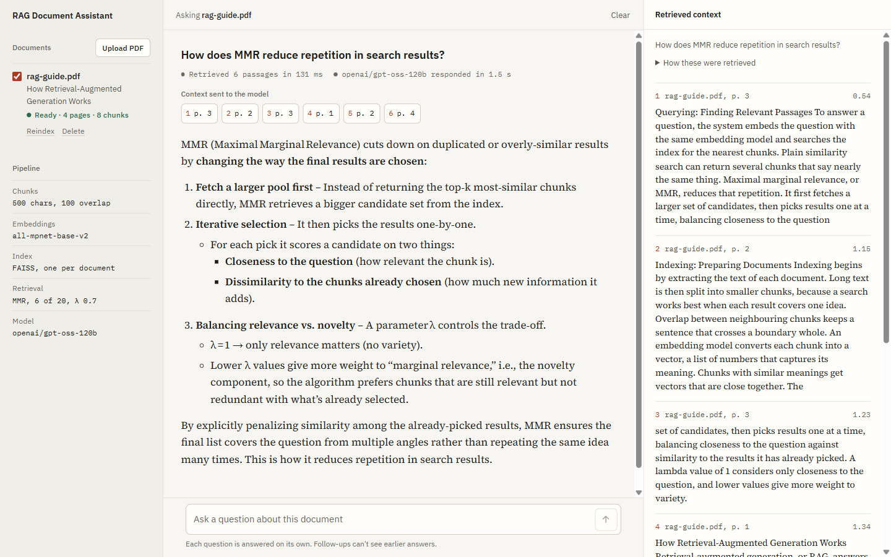

# RAG Document Assistant

Upload PDFs, choose which ones to search, and ask questions. Answers come from a language model given only the passages retrieved from your selected documents, and those passages stay beside the answer with their document, page and distance, so you can check it.



## Features

- **PDF upload** with validation, duplicate detection and a size limit
- **Background indexing** with truthful status: waiting, indexing, ready or failed with a reason
- **Persistent per-document indexes**, so a document is embedded once and reused after restarts
- **Scoped retrieval** across only the documents you select
- **Sources from retrieval metadata**: document, PDF page, distance and text for every passage
- **Streamed answers**, with retrieval and generation shown as they actually happen
- **Reindex and delete** for one document at a time
- A clear "not found" result when the model reports that the passages don't answer the question

## Architecture

```text
React + TypeScript         Documents | Conversation | Retrieved context
        │  REST, and newline-delimited JSON for streamed answers
        ▼
FastAPI (api.py)           A thin HTTP layer
        │
        ▼
Document registry          Uploads, status, and one background indexing worker
(document_store.py)
        │
        ▼
RAG pipeline (rag_core.py)
  Indexing:  PDF → content pages → chunks → embeddings → FAISS index saved per document
  Querying:  question → search selected indexes → merge → MMR → prompt → Groq → answer
```

### Document storage

There's no database. Each document is a folder, ignored by git:

```text
documents/<generated-id>/
    original.pdf       The uploaded file, always stored under this name
    manifest.json      Filename, SHA-256, status, page and chunk counts, settings, any error
    index/             That document's FAISS index
    questions.json     Optional suggested questions
```

### Document lifecycle

```text
uploaded → indexing → ready
                    ↘ failed (with a reason, and a retry)
```

### Why indexing is separate from startup

Embedding a 500-page PDF takes several minutes on a CPU. That work is only worth doing once, so it's an explicit operation that runs only after an upload or a reindex request.

Starting the application:

- reads each document's manifest and checks its saved files
- then, in the background, loads the embedding model and opens saved indexes

It never parses a PDF, generates document embeddings or builds an index. If an index is missing, damaged or out of date, that document reports `failed` with a reason and offers a reindex. Nothing rebuilds automatically.

### Retrieval

The embedding model, chunk settings and MMR settings are fixed in `rag_core.py`, so results stay comparable:

| Setting | Value |
|---|---|
| Embedding model | `sentence-transformers/all-mpnet-base-v2` |
| Chunks | 500 characters, 100 overlap |
| Candidates | 20 |
| Passages returned | 6 |
| MMR λ | 0.7 |
| LLM | `openai/gpt-oss-120b` on Groq |

Each selected index returns its 20 nearest chunks. They're merged by distance, the closest 20 are kept, and MMR selects 6. With one document this gives exactly the same result as FAISS's own MMR search. If no document is selected, the API refuses the question rather than searching everything.

Page selection works from each page's content, skipping blank pages, tables of contents, back-of-book indexes and copyright pages.

## Run it locally

You'll need Python 3.11 or later, Node.js, and a free [Groq API key](https://console.groq.com).

```bash
git clone https://github.com/bangarukondabollapally/rag-document-assistant.git
cd rag-document-assistant

python -m venv .venv
.venv\Scripts\activate          # Windows
source .venv/bin/activate       # macOS or Linux
pip install -r requirements.txt

copy .env.example .env          # Windows
cp .env.example .env            # macOS or Linux
```

Add your key to `.env`, then start the frontend and API together:

```bash
cd frontend
npm install
npm run dev
```

Open http://localhost:5173. To try it straight away, upload `samples/rag-guide.pdf`, a short guide written for this project. The embedding model is downloaded the first time it's needed.

`npm run dev` uses the API on port 8000 if one is already running. `npm run dev:web` starts only the frontend, and `uvicorn api:app --port 8000` starts only the API.

### Reindexing

Use **Reindex** on a document in the sidebar, which rebuilds only that document. Documents can also be managed from the command line, with the API stopped, since a running API reads the registry once at startup:

```bash
python document_store.py list
python document_store.py add samples/rag-guide.pdf
python document_store.py reindex <id>
python document_store.py delete <id>
```

### Environment variables

| Variable | Purpose | Default |
|---|---|---|
| `GROQ_API_KEY` | Needed to generate answers | None |
| `RAG_LLM_MODEL` | The Groq model | `openai/gpt-oss-120b` |
| `RAG_DOCUMENTS_DIR` | Where PDFs and indexes are stored | `documents` |
| `RAG_MAX_UPLOAD_MB` | The largest PDF accepted | `50` |

## Tests

```bash
pip install -r requirements-dev.txt
pytest

cd frontend
npm test
npm run typecheck
npm run lint
npm run build
```

The backend tests use generated PDFs, fake embeddings and a fake LLM, so they need no API key or model download. They include regression tests proving that startup never parses, chunks, embeds or rebuilds.

## API

| Method and path | Purpose |
|---|---|
| `GET /api/workspace` | Documents, index status, settings and limits |
| `GET /api/documents`, `GET /api/documents/{id}` | Document metadata |
| `POST /api/documents` | Upload a PDF and queue it for indexing |
| `POST /api/documents/{id}/reindex` | Rebuild one document's index |
| `DELETE /api/documents/{id}` | Delete a document, its metadata and its index |
| `POST /api/query` | Ask a question of `selected_document_ids`, as a stream of events |

The query stream sends `stage`, `sources`, `token`, and then `done` or `error`. Sources arrive before the answer and contain `document_id`, `document`, `page`, `distance`, `rank` and `text`.

## Limitations

This is a local, single-user portfolio project, not a production service.

- **No authentication:** anyone who can reach the API can upload, read and delete documents. Don't expose it to a network as it is.
- **Passages aren't claim-level citations:** they show what the model was given, but nothing verifies that each sentence of an answer is supported by them. Answers should be checked against the sources.
- **The refusal is the model's own:** there's no separate relevance check, so "not found" relies on the model following its prompt.
- **Large documents can dominate:** results are merged by distance alone, so on a broad question a large document can crowd out a small one. Selecting only the small document avoids this.
- **No conversation memory:** each question is answered on its own, so follow-ups can't refer to earlier answers.
- **Text PDFs only:** scanned PDFs have no extractable text and fail with that reason. There's no OCR.
- **No progress percentage:** indexing reports its state rather than an estimate, and a long build isn't resumable. If it's interrupted, the document reports `failed` and can be retried.
- **One indexing job at a time:** further uploads wait in a queue.
- **Saved indexes use pickle:** FAISS stores its text that way, and loading a pickle can run code. Only load indexes this application created.
- **Rate limits:** Groq's free tier limits tokens per minute. The app reports this and offers a retry.

## Project structure

```text
api.py               HTTP layer
document_store.py    Document registry, uploads, and the indexing worker
rag_core.py          Page selection, chunking, FAISS, retrieval and generation
app.py               A simple Streamlit interface over the same core
frontend/            React and TypeScript workspace
samples/             A small PDF that's safe to share, and the script that writes it
tests/               Backend tests
```

Only share documents you have the right to share. Uploaded PDFs and generated indexes are ignored by git.
